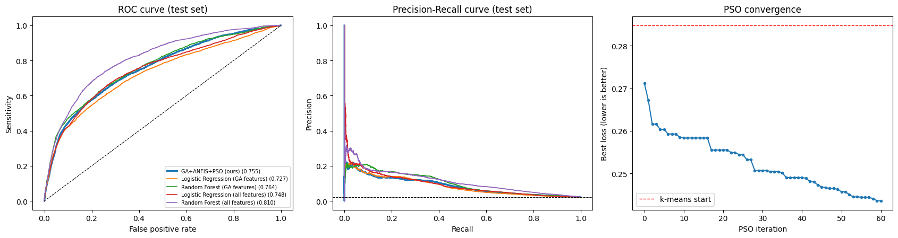
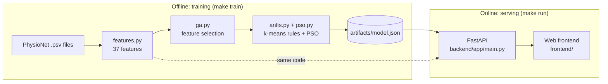

<div align="center">


# Sepsis Early Warning
### Fuzzy ICU risk model built with a Genetic Algorithm, ANFIS and Particle Swarm Optimization

Soft Computing AAT (MMCE30C3) · MCA, Department of Computer Applications · B.M.S. College of Engineering, Bengaluru

</div>

> ⚠️ **Research prototype. Not a medical device.** It must not be used for clinical decisions. See [limitations and ethics](docs/LIMITATIONS_AND_ETHICS.md).

## What is this?

Sepsis is a life-threatening reaction to infection and a leading cause of ICU deaths; every hour of delayed treatment lowers survival by about 7.6 %. This project predicts sepsis risk **hour by hour** from routine ICU measurements and, unlike a black-box score, explains every alert with **readable fuzzy IF-THEN rules**.

Three soft-computing techniques work together:

| Stage | Technique | Job |
|---|---|---|
| 1 | **Genetic Algorithm (GA)** | picks the 3-6 most useful of 37 candidate features |
| 2 | **ANFIS** (Takagi-Sugeno fuzzy system) | turns them into 8 fuzzy rules with bell-shaped membership curves |
| 3 | **Particle Swarm Optimization (PSO)** | tunes the centre and width of every curve |

The repository contains the complete end-to-end system: data download, training pipeline, a JSON model artifact, a **FastAPI** backend and a clean **web frontend**, plus tests, Docker, CI and documentation.

## Results (reference run, PhysioNet 2019 Training Set A)

Trained on 20,336 patients, tested on **unseen patients** at the **natural 2.14 % sepsis rate** (159,397 hourly rows). The alert threshold was chosen on separate validation patients (target sensitivity ≈ 80 %).

| Model | AUROC | AUPRC | Sensitivity | Precision | False alarms / true alert |
|---|---:|---:|---:|---:|---:|
| **GA + ANFIS + PSO (this work)** | **0.755** | 0.086 | 83.7 % | 3.3 % | 29.6 |
| Logistic Regression (same 5 features) | 0.727 | 0.084 | 84.3 % | 2.9 % | 33.9 |
| Random Forest (same 5 features) | 0.764 | 0.099 | 85.0 % | 3.3 % | 29.2 |
| Logistic Regression (all 37 features) | 0.748 | 0.093 | 82.6 % | 3.2 % | 30.3 |
| Random Forest (all 37 features) | 0.810 | 0.111 | 82.5 % | 4.5 % | 21.4 |

The first version of this project (3 inputs, 2,000 patients, balanced test set) reached AUROC 0.61. **Read the honest limitations** in [docs/RESULTS.md](docs/RESULTS.md): precision is low (about 30 false alarms per true alert) and the GA selected *hours in ICU*, a time proxy. A fully worked report is in [`report/`](report/Soft_Computing_AAT_Report.pdf).

<p align="center"></p>

## Quick start

> **The app runs only on the real trained model.** There is no demo or stand-in model: without `artifacts/model.json` the app shows a clear message and refuses to score anyone.

### Step 1: get your trained model (`artifacts/model.json`)
Export it from the Google Colab notebook where it was trained (no retraining; takes seconds if the session is still open):
1. In that Colab session add a new last cell, paste [`scripts/colab_export_model_cell.py`](scripts/colab_export_model_cell.py) and run it. It downloads `model.json`.
2. Copy `model.json` into the `artifacts/` folder, commit it (it is a small JSON file).

Full guide, including what to do if the Colab session was closed: [docs/EXPORT_FROM_COLAB.md](docs/EXPORT_FROM_COLAB.md). The alternative is `make train` (retrains locally on PhysioNet data, about 10-15 minutes; numbers may differ slightly from the Colab run).

### Step 2: run the app

**GitHub Codespaces (no install)**: *Code → Codespaces → Create codespace*, then in the terminal `make run` and open port **8000**.

**Local machine (Python 3.10+)**
```bash
git clone https://github.com/<your-username>/sepsis-early-warning.git
cd sepsis-early-warning
python3 -m venv .venv && source .venv/bin/activate     # Windows: .venv\Scripts\activate
make install            # or: pip install -r requirements-dev.txt
make run                # or: ./scripts/run.sh  (Windows: scripts\run.bat)
```
Open **http://localhost:8000** (API docs at **/docs**). Check that `GET /api/health` reports `"model_source": "colab-notebook-v2"`.

**Docker**: `docker compose up --build` → http://localhost:8000 (the image contains `artifacts/model.json`).

### Optional: retrain locally instead of exporting
```bash
make train-quick        # 3,000 patients, about 5 minutes
make train              # all 20,336 patients, about 10-15 minutes (downloads about 20,000 small files)
```
This downloads PhysioNet Training Set A (public, no login) into `data/setA/`, runs GA → ANFIS → PSO, compares with baselines and writes `artifacts/model.json`. With Docker: `docker compose --profile train run --rm trainer`.

## The web app

| Page | What you can do |
|---|---|
| **Patient monitor** | Load an example, upload a PhysioNet `.psv` file or type hourly values. Get risk per hour, alerts, a *sustained alert* flag, and a click-through **"Why this hour?"** panel showing the fuzzy rules that fired. |
| **How the model works** | The six pipeline stages with live numbers, GA and PSO convergence curves, the chosen features, and every fuzzy rule in plain language. |
| **Performance** | AUROC, AUPRC, sensitivity, precision, ROC and PR curves, baseline comparison and confusion matrix of the loaded model, plus the static reference results from the report. |
| **About & safety** | Clinical background, data source, limits and how to reproduce. |

The frontend is plain HTML, CSS and JavaScript (no build step, no external libraries) served by the same FastAPI process, so one command runs everything.

## Architecture


Training and serving share the **same** feature code, so what the model sees in production is what it saw in training. Details: [docs/ARCHITECTURE.md](docs/ARCHITECTURE.md).

## API in one minute

```bash
curl -s localhost:8000/api/samples/shock | python3 -c "import sys,json; d=json.load(sys.stdin); print(json.dumps({'hours':d['hours'],'age':d['age']}))" \
 | curl -s -X POST localhost:8000/api/predict -H 'Content-Type: application/json' -d @- | python3 -m json.tool | head -30
```
| Method | Path | Purpose |
|---|---|---|
| GET | `/api/health` | status and loaded model |
| GET | `/api/model` | features, rules, metrics, curves, histories |
| GET | `/api/features`, `/api/schema` | feature catalogue, input fields |
| GET | `/api/samples`, `/api/samples/{id}` | synthetic example input patients |
| POST | `/api/predict` | score a patient's hourly records |
| POST | `/api/predict/psv` | upload a PhysioNet `.psv` file |
| GET | `/api/reference` | static results of the report run |

Full reference with request and response examples: [docs/API.md](docs/API.md).

## Repository layout

```
sepsis-early-warning/
├── backend/
│   ├── app/                 FastAPI app (main.py, schemas.py, data/reference_results.json)
│   └── sepsis/              ML package: config, data, features, ga, anfis, pso, metrics, train, model, samples
├── frontend/                index.html, css/styles.css, js/app.js, js/charts.js
├── artifacts/               model.json (the trained model; export it from Colab)
├── data/                    PhysioNet files are downloaded here (git-ignored)
├── samples/                 three synthetic EXAMPLE INPUT patients (.psv); not a model
├── tests/                   26 tests: features, ANFIS, training, model, API (use a tiny synthetic model, test-only)
├── docs/                    architecture, methodology, API, results, user guide, development, ethics
├── notebooks/               the original Google Colab notebook with its outputs
├── report/                  AAT report (PDF + LaTeX source)
├── scripts/                 run.sh, run.bat, make_samples.py
├── Makefile · Dockerfile · docker-compose.yml · .devcontainer/ · .github/workflows/ci.yml
└── requirements.txt · requirements-dev.txt · LICENSE · CITATION.cff · CHANGELOG.md
```

## Method in brief

1. **Data split by patient** (60/20/20) so no patient is in two parts; the test set keeps the real 2 % sepsis rate.
2. **Features**: last-known vitals and labs, shock index, ICU hours, how often each lab was ordered, and 6-hour change / mean / variability of the vitals. Only past values are used (checked by a unit test).
3. **GA** (population 30, 25 generations): 37-bit chromosome, fitness = AUROC of a quick logistic regression minus 0.004 per feature, 3-6 features allowed.
4. **ANFIS**: k-means groups patients into 8 rules; each rule has Gaussian curves per input and a linear output; rule outputs are blended by normalised firing strength. Output formulas are solved by weighted ridge least squares (Jang's hybrid learning).
5. **PSO** (40 particles, 60 rounds, inertia 0.9 → 0.4) searches centres and widths, warm-started from k-means; fitness = (1 − AUROC) + 0.1 × weighted squared error on held-out patients.
6. **Calibration** by Platt scaling, **alert threshold** from validation data for ≈ 80 % sensitivity, one final evaluation on test patients, baselines for comparison.

Full derivation: [docs/METHODOLOGY.md](docs/METHODOLOGY.md).

## Testing
```bash
make test        # 26 tests, about 6 seconds
make lint-js     # frontend syntax check
```
CI runs both on Python 3.10-3.12 ([workflow](.github/workflows/ci.yml)).

## Limitations (please read)
- Precision about 3 %: roughly 30 false alarms per true alert when scoring every hour.
- The GA selected *hours in ICU*, a time indicator rather than a physiological signal.
- One public dataset (US hospitals, Training Set A), one training run; no external validation.
- The example patients on the monitor page are synthetic **inputs** for trying the interface; the model itself is trained only on PhysioNet data.
- The *sustained alert* (≥ 3 consecutive hours) on the monitor page is a usability extension that was **not** part of the evaluation.

## Roadmap
Evaluate a persistence rule for alerts · ablation without ICU hours · more PSO rounds and rules · Training Set B for external validation · time-series features beyond 6 hours.

## Team
**Lohith S** (1BM25MC052) · **Manjunath H** (1BM25MC054), under the guidance of **Dr. K Vijayakumar**, Professor, Department of Computer Applications, B.M.S. College of Engineering, Bengaluru.

## Data, references and licence
- Data: PhysioNet / Computing in Cardiology Challenge 2019. M. Reyna et al., *Early Prediction of Sepsis from Clinical Data*, Critical Care Medicine 48(2):210-217, 2020. Please follow the dataset's own terms of use.
- J.-S. R. Jang, *ANFIS: Adaptive-Network-Based Fuzzy Inference System*, IEEE Trans. SMC 23(3), 1993 · J. Kennedy and R. Eberhart, *Particle Swarm Optimization*, ICNN 1995 · D. E. Goldberg, *Genetic Algorithms in Search, Optimization and Machine Learning*, 1989 · L. Breiman, *Random Forests*, Machine Learning 45(1), 2001.
- Code released under the [MIT License](LICENSE). Cite via [CITATION.cff](CITATION.cff).
