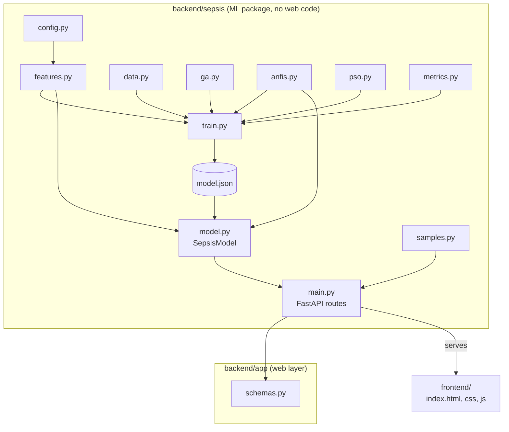

# Architecture

## Components

| Layer | Responsibility |
|---|---|
| `sepsis.features` | The only place features are computed. Used by training **and** by every API request. |
| `sepsis.ga`, `sepsis.anfis`, `sepsis.pso` | The three soft-computing techniques, each a small, independently testable module. |
| `sepsis.train` | Orchestrates the split, features, GA, ANFIS, PSO, calibration, baselines and writes the artifact. |
| `sepsis.model` | Loads the artifact, scores a patient, explains the result with rule activations. |
| `app.main` | HTTP routes, input validation, static file serving. Contains no ML logic. |
| `frontend/` | Vanilla JS single-page app; talks only to `/api/*`. |

## Data flow of one prediction

1. The frontend sends hourly raw records to `POST /api/predict` (or uploads a `.psv` file).
2. `SepsisModel.predict` builds the 37 features with `features.build_features` (forward fill, 6-hour trends, lab counts).
3. Missing values are imputed with the **training** medians, then standardised with the **training** mean and standard deviation and clipped to ±5.
4. Only the GA-selected columns enter the ANFIS: Gaussian membership → product → normalised rule strengths → linear rule outputs → weighted sum.
5. A sigmoid (Platt scaling, coefficients stored in the artifact) turns the score into a probability; it is compared with the validation-chosen threshold.
6. The response contains risk, alert flags, the sustained-alert flag, per-rule activation, and the inputs used. The UI turns the top rule into a plain-language explanation.

## Model artifact (`artifacts/model.json`)

A single human-readable JSON file (no pickle, so it is safe to inspect and version).

| Key | Content |
|---|---|
| `source` | `colab-notebook-v2` (exported from the notebook) or `physionet-2019-setA` (trained with `make train`) |
| `features` | all 37 names, selected names and indices |
| `preprocessing` | training medians, mean, std, clip value, observed ranges of selected features |
| `anfis` | rule centres, widths and linear output coefficients |
| `calibration`, `alert` | Platt coefficients, alert threshold, target sensitivity |
| `metrics`, `curves`, `history`, `timing`, `dataset`, `config` | everything the UI shows on the *Model* and *Performance* pages |

Model lookup at start-up: `$MODEL_PATH`, otherwise `artifacts/model.json`. **There is no fallback model**: if neither exists the API answers `503` with instructions and the UI explains how to export the model.

## Design decisions

- **One process, one port.** FastAPI serves the API and the static frontend, so Codespaces, Docker and a laptop all work with a single command.
- **Shared feature code** removes train/serve skew; a unit test proves no feature uses future data.
- **No stand-in model.** This is a medical-domain project, so the app refuses to score anyone unless the real trained model is present.
- **Patient-level splits** everywhere; thresholds are chosen on validation data only.
